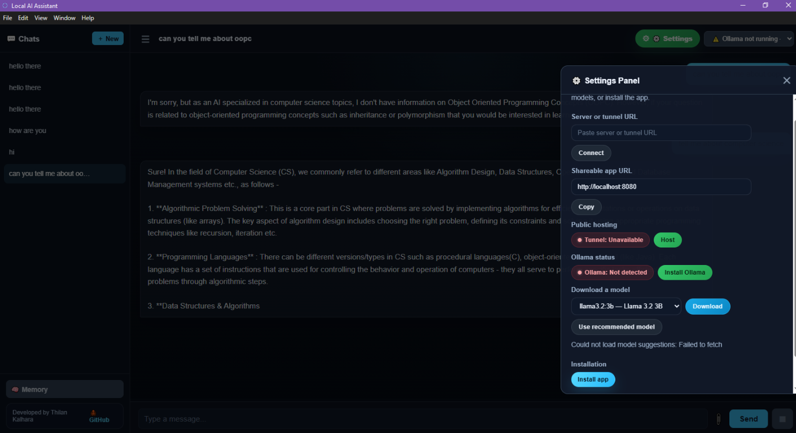

# 🤖 Local AI Assistant


[](https://github.com/Thilankalhara/LLM-host-local-server/releases/tag/v1.0.0)
[](https://github.com/Thilankalhara/LLM-host-local-server/releases/latest)

A privacy-first local AI chat application powered by [Ollama](https://ollama.com) and Express.js.
Run conversations, memory, file uploads, model management, and optional public tunnelling
on your own Windows PC — with no API costs and no required cloud service.



## Download for Windows

Download the latest installer from the
[GitHub Releases page](https://github.com/Thilankalhara/LLM-host-local-server/releases/latest).
The installer creates Start Menu and desktop shortcuts and lets you choose the installation
directory. Ollama must be installed separately because the AI model runs locally on your PC.

> **Windows installer:** The release asset is named `Local AI Assistant-<version>-x64.exe`.
> For portable use, download the portable `.exe` asset when it is available.

---

## ✨ Features

- 💬 **Chat history** — all conversations saved and reloadable
- 🧠 **Memory** — save facts the AI always remembers
- 📎 **Multiple file uploads** — attach `.txt`, `.csv`, `.json`, `.html`, `.md` files
- ⚡ **Streaming** — see the AI typing word by word
- ⏹ **Stop button** — cancel generation anytime
- 📋 **Copy code** — one-click copy any code block
- ⬇️ **Download code** — download code blocks as files with correct extension
- ☰ **Collapsible sidebar** — more space when you need it
- 📱 **Installable app** — install it like a desktop/web app from the browser
- 🟢 **Ollama status** — see whether Ollama is running before you send
- ✨ **Splash screen** — animated launch screen on startup
- 🪟 **Windows EXE build** — Electron packaging available for a portable `.exe`
- ⚙️ **Settings panel** — connect, host, download models, and install from one place
- 🌐 **Public tunnel** — generate a shareable URL with Dev Tunnels
- 📦 **Smart model download** — recommended and installed models are shown automatically

---

## 📋 Requirements

| Tool | Version | Download |
|------|---------|----------|
| Node.js | v18 or higher | https://nodejs.org |
| Ollama | Latest | https://ollama.com/download |

---

## 📁 Folder Structure

```
project/
├── server.js           ← Backend server
├── package.json        ← Node dependencies
├── data/               ← Auto-created on first run
│   ├── chats.json      ← Chat history
│   └── memory.json     ← Saved memories
├── uploads/            ← Temp folder for file uploads
└── public/             ← Frontend files
    ├── index.html
    ├── style.css
    └── script.js
```

---

## 🚀 Setup & Run

### Step 1 — Install Ollama

Download from https://ollama.com/download and install it.

### Step 2 — Pull an AI model

Open PowerShell or Terminal and run:

```powershell
ollama pull deepseek-coder:1.3b
```

> 💡 See other model options at the bottom of this file.

### Step 3 — Clone or download this project

Put all files in a folder. Make sure the structure matches the one above.

### Step 4 — Install Node.js packages

Open PowerShell **inside your project folder** and run:

```powershell
npm install
```

### Step 5 — Create data folder

```powershell
mkdir data
```

### Step 6 — Start the server

You can start the server in either of these ways:

**Option A (Recommended):**
```powershell
npm start
```

**Option B:**
```powershell
node server.js
```

You should see:
```
✅ Server running at http://localhost:8080
```

### Step 7 — Open in browser

Go to: **http://localhost:8080**

Click **⚙️ Settings** to open the panel for host, connect, download, and install actions.

### Windows installer build

On Windows, build the NSIS installer and portable package with:

```powershell
npm install
npm run dist:installer
```

The installer is written to `dist/Local AI Assistant-<version>-x64.exe`.
To build both the installer and portable package, run `npm run dist`.

---

## ⚙️ Settings Panel

The **Settings** panel is the control center for the app. It lets the user do everything from one place:

- Connect to a local server or paste a tunnel URL
- Host a public tunnel with Dev Tunnels
- See whether Ollama is running or missing
- Download recommended or installed models
- Install the app as a desktop/web app
- Toggle web search

### How each part works

#### 1) Connect to a server
The user can paste a server URL into the field and click **Connect**. This tells the browser where the backend API is running.

- If the app is running locally, it usually auto-detects the normal local API URL.
- If the user is connecting to a remote machine or a public tunnel, they paste that URL here instead.

#### 2) Host a public tunnel
Click **Host** to start a secure public tunnel through Dev Tunnels. The app then exposes the local server through a public URL so someone else can access it.

- This is useful for demos or remote access.
- The app tracks the tunnel state and shows whether it is live, starting, or offline.

#### 3) Ollama status
The panel checks whether Ollama is running on the machine. If it is not detected, the app shows a warning and can point the user to the Ollama download page.

- This prevents the user from guessing which model to install.
- It also shows whether the local AI backend is reachable.

#### 4) Download models
The app lists:

- installed models already on the machine
- recommended models for the current device
- all supported models

It uses the hardware profile (RAM and CPU cores) to suggest a good default model so the user does not have to guess.

#### 5) Install the app
This uses the browser install prompt to add the app to the Start menu / desktop / home screen if supported.

- On a browser, it behaves like a PWA install.
- On a packaged desktop build, it can also behave like a desktop application install.

#### 6) Internet search toggle
The **Internet** button lets the user enable web search while chatting. When enabled, the app adds search results to the system prompt so the answer can use current information.

The download dropdown automatically groups:

- Installed models
- Recommended models for the current device
- All supported models

---

## 💬 How to Use

### Chatting
1. Click **＋ New** in the sidebar to start a new chat
2. Type your message and press **Enter** or click **Send**
3. The AI will respond word by word (streaming)
4. Click **⏹** to stop the AI mid-response

### Chat History
- All chats are saved automatically
- Click any chat in the sidebar to reload it
- Click ✏️ to rename a chat
- Click 🗑️ to delete a chat
- Click ☰ to collapse/expand the sidebar

### Memory
- Click **🧠 Memory** at the bottom of the sidebar
- Add facts like:
  - `My name is John`
  - `I prefer Python over JavaScript`
  - `I am working on a React project`
- The AI will remember these in every conversation
- Click 🗑️ next to any memory to delete it

### File Uploads
- Click **📎** to attach files (supports multiple)
- Supported: `.txt`, `.csv`, `.json`, `.html`, `.md`
- Files appear as chips — click ✕ to remove before sending

### Code Blocks
- AI responses with code show a **header bar**
- Click **📋 Copy** to copy the code to clipboard
- Click **⬇️ Download** to save the code as a file (auto-detects extension: `.py`, `.js`, `.html`, etc.)

---

## ⚙️ Changing the AI Model

Edit line in `server.js`:

```js
model: 'deepseek-coder:1.3b',
```

Replace with your model name. Check installed models:

```powershell
ollama list
```

### Recommended models by device size

| Model | Command | Best for |
|-------|---------|----------|
| `llama3.2:1b` | `ollama pull llama3.2:1b` | Low-RAM devices |
| `phi3:mini` | `ollama pull phi3:mini` | Low-RAM devices |
| `llama3.2:3b` | `ollama pull llama3.2:3b` | Balanced general chat |
| `qwen2.5:3b` | `ollama pull qwen2.5:3b` | Balanced general chat |
| `qwen2.5-coder:3b` | `ollama pull qwen2.5-coder:3b` | Coding on mid-range PCs |
| `mistral:7b` | `ollama pull mistral:7b` | Stronger general chat |
| `llama3.1:8b` | `ollama pull llama3.1:8b` | High-memory PCs |
| `qwen2.5-coder:7b` | `ollama pull qwen2.5-coder:7b` | High-memory coding |
| `gemma2:9b` | `ollama pull gemma2:9b` | Larger machines |

> ⚠️ The app recommends models based on device memory and CPU cores, but Ollama and Windows memory limits still apply.

---

## 🛠️ Troubleshooting

**"Cannot find package 'ollama'"**
```powershell
npm install ollama express multer
```

**"Cannot use import statement"**
```powershell
npm pkg set type="module"
```

**Send button does nothing**
- Open browser F12 → Console tab and check for red errors
- Make sure `node server.js` is running in the terminal
- Make sure you're in the right project folder

**No AI response / model error**
- Check Ollama is running: `ollama serve`
- Check model is installed: `ollama list`
- Make sure model name in `server.js` matches exactly

**Port already in use**
- Change `3000` to `3001` in `server.js`
- Visit `http://localhost:3001`

**Settings panel does not open**
- Hard refresh the page so the latest CSS and script load
- Click the green **⚙️ Settings** button in the top bar
- If the page is narrow, the panel still opens as a drawer from the right

**Model download list is empty**
- Open Settings and check that Ollama is running
- Try downloading a model directly after connecting to the local server
- Make sure the browser can reach the server at `http://localhost:3000`

**"Could not create chat: Server error (405)"**

This error occurs when the browser blocks POST requests to `/api/chats` due to CORS (Cross-Origin Resource Sharing) preflight failures. **This project already includes the fix** — the code handles:

- ✅ **CORS middleware** — automatically sends required headers for browser requests
- ✅ **OPTIONS preflight handler** — responds to browser preflight checks
- ✅ **Static middleware ordering** — places API routes before static file serving to prevent method conflicts

**If you still see this error after a fresh install:**

1. Make sure you're opening the app at **http://localhost:8080** (not `file://` or another origin)
2. Make sure `npm start` is running (see terminal for `✅ Server running at http://localhost:8080`)
3. Hard-refresh the browser: `Ctrl+Shift+R` (Windows/Linux) or `Cmd+Shift+R` (Mac)
4. Check DevTools (F12) → Network tab → find the `/api/chats` request → paste the **Status**, **Request/Response Headers**, and **Response body** in an issue

The fix is built into this version — no additional setup needed. If you're on another PC and the error persists, verify:
- Node.js version is 18+ (`node --version`)
- All dependencies installed (`npm install`)
- Server logs show no errors when starting

---

## 📄 License

MIT — free to use, modify, and share.
